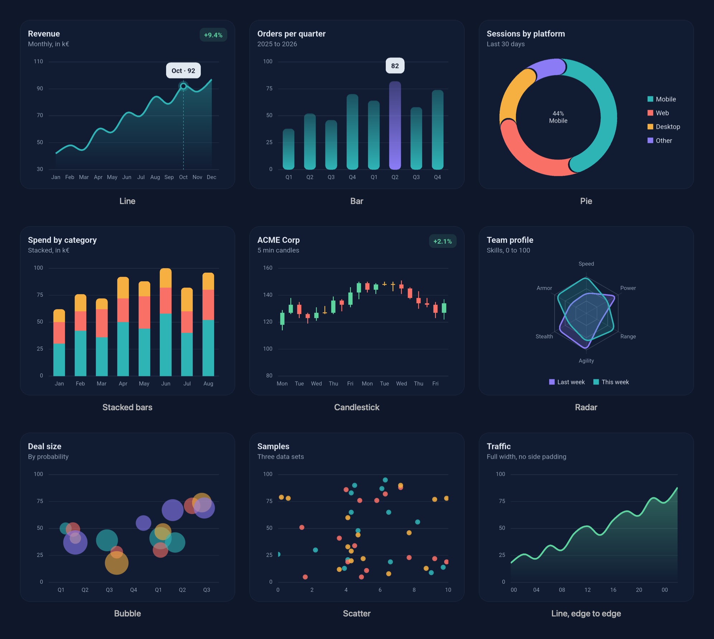
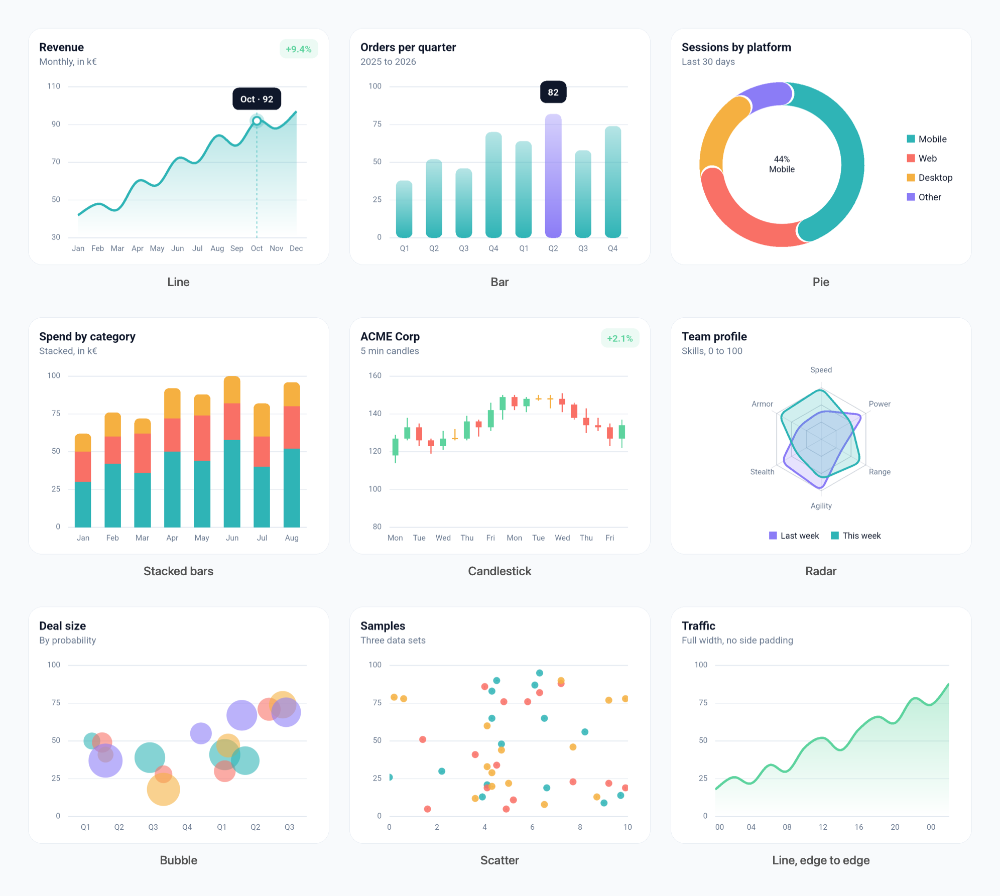
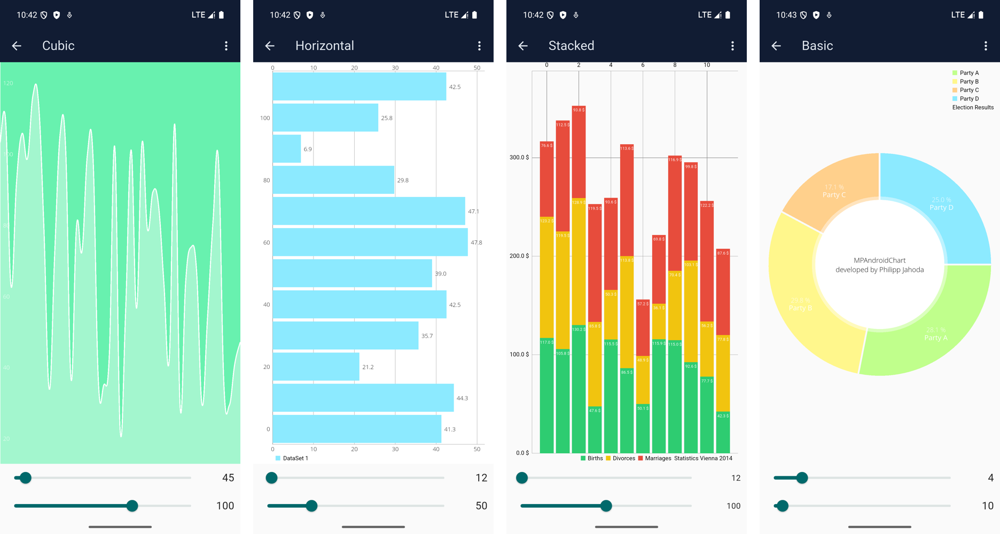

# mp_flutter_chart

A Flutter port of [MPAndroidChart](https://github.com/PhilJay/MPAndroidChart) v4.0.1, class for class: the same
class and member names as MPChartLib, written in pure Dart on top of `dart:ui`, with a Flutter widget layer on top.
It runs on Android, iOS and HarmonyOS (OpenHarmony Flutter), and as pure Dart it also builds for the web and desktop.

## Gallery

The example app opens with every chart type in one consistent style, in a dark and a light variant, as
MPChartExample does. These are screenshots of the Flutter example app on Android, drawn by this package.





The other pages of the example app follow MPChartExample's Activities: here the Cubic line, Horizontal bar, Stacked
bar and Basic pie pages.



## Based on MPAndroidChart

This package is a derivative work of **MPAndroidChart** by Philipp Jahoda and the MPAndroidChart contributors,
licensed under the Apache License 2.0. It was ported from the Kotlin sources (v4.0.1) of
<https://github.com/PhilJay/MPAndroidChart>, `master` at commit `fae4ad798564ea9ad494eaf037dca0e745400723`.

- The chart classes (`Chart`, `BarLineChartBase`, the data sets, axes, renderers, highlighters, touch listeners,
  `ViewPortHandler`, `Transformer`, …) keep MPChartLib's names, structure and behaviour, so code and knowledge from
  MPAndroidChart carry over.
- Android's `Canvas`, `Paint`, `Path` and `Matrix` are replaced by small shims over `dart:ui`, and Android's touch
  handling by Flutter gestures. Where the port has to differ from Android, the difference and its reason are listed
  in [`MIGRATION.md`](MIGRATION.md).
- The original copyright notice is kept in [`NOTICE`](NOTICE).

This project is not affiliated with or endorsed by the MPAndroidChart authors.

## Chart types

| Chart | Widget | Data |
|---|---|---|
| Line | `LineChart` | `LineData` |
| Bar | `BarChart` | `BarData` |
| Horizontal bar | `HorizontalBarChart` | `BarData` |
| Scatter | `ScatterChart` | `ScatterData` |
| Candlestick | `CandleStickChart` | `CandleData` |
| Bubble | `BubbleChart` | `BubbleData` |
| Pie | `PieChart` | `PieData` |
| Radar | `RadarChart` | `RadarData` |

Every chart supports MPAndroidChart's axes, legend, description, markers, highlighting, value formatters and
animations. Bar-line charts zoom and pan by drag, pinch, double tap and fling; pie and radar charts rotate by touch.
`CombinedChart` is not ported yet.

## Install

```yaml
dependencies:
  mp_flutter_chart: ^0.1.0
```

Requires Flutter 3.35 or later (Dart 3.9 or later).

## Quick start

```dart
import 'package:flutter/material.dart' hide Easing; // Material 3 has an `Easing` of its own
import 'package:mp_flutter_chart/mp_flutter_chart.dart';

class SalesChart extends StatefulWidget {
  const SalesChart({super.key});

  @override
  State<SalesChart> createState() => _SalesChartState();
}

class _SalesChartState extends State<SalesChart> {
  final controller = ChartController(); // optional: selection, zoom, animations
  final data = LineData([
    LineDataSet([Entry(x: 0, y: 3), Entry(x: 1, y: 5), Entry(x: 2, y: 4)], 'Sales')
      ..mode = LineDataSetMode.CUBIC_BEZIER,
  ]);

  @override
  void dispose() {
    controller.dispose();
    super.dispose();
  }

  @override
  Widget build(BuildContext context) => SizedBox(
    height: 300,
    child: LineChart(
      data: data,
      controller: controller,
      // Runs once with the chart (a `LineChartView`, MPAndroidChart's `LineChart`) before the data is set.
      setup: (chart) => chart.axisRight.isEnabled = false,
    ),
  );
}
```

`controller.animateX(1000)`, `controller.fitScreen()` and `controller.selectedEntry` (listen with a
`ListenableBuilder`) drive and read the chart. The other chart widgets take the same parameters; their `setup` and
`update` callbacks get a `BarChartView`, `HorizontalBarChartView`, `ScatterChartView`, `CandleStickChartView`,
`BubbleChartView`, `PieChartView` or `RadarChartView`, which is the MPAndroidChart chart object with its full API.

There are two entry points:

- `package:mp_flutter_chart/mp_flutter_chart.dart`: the widgets, plus the MPChartLib classes they use.
- `package:mp_flutter_chart/core.dart`: only the MPChartLib classes, where `LineChart`, `BarChart` and the other
  chart names are the chart classes themselves.

Import one of the two per file (importing both makes the eight chart names ambiguous), or import `core.dart` with a
prefix.

## Example

[`example/`](example) is a Flutter app with Android, iOS and HarmonyOS projects. Its home list follows
MPChartExample's, and each entry opens the port of its Activity: the "All chart types" showcase in the dark and
light Nightfall style, and a page for every other entry with the Activity's chart setup, data, options menu and
controls. Combined Chart and From Java have no page; see [`example/README.md`](example/README.md).

```sh
cd example
flutter run
```

## Development

```sh
flutter pub get
flutter analyze
flutter test --exclude-tags golden,perf
dart run tool/api_parity.dart --scope=all
```

- `flutter test --platform chrome test/unit test/widget` runs the unit and widget tests in a browser.
- `golden` tests (`test/golden/`) compare against PNGs rendered on macOS and are skipped on other hosts; regenerate
  them on macOS with `flutter test --update-goldens test/golden`.
- `perf` tests (`test/perf/`) print timings for large data sets and have no thresholds.
- `tool/api_parity.dart` scores `lib/src` against MPChartLib's public API dump (`tool/MPChartLib.api`), with the
  symbols that are deliberately not ported listed in `tool/api_whitelist.yaml`. See [`tool/README.md`](tool/README.md).

For HarmonyOS, use the [OpenHarmony Flutter SDK](https://gitcode.com/openharmony-tpc/flutter_flutter): set
`OHOS_FLUTTER` to its `bin/flutter` and run commands through `tool/flutter.sh`, or build and install the example with
`scripts/ohos_build.sh --install`. A HarmonyOS device needs a signing config from DevEco Studio; without one the
build stops at an unsigned HAP, which an emulator accepts through `hdc install`.

## License

Apache License 2.0, see [`LICENSE`](LICENSE). The original MPAndroidChart copyright notice (Philipp Jahoda,
2014-2026) is retained in [`NOTICE`](NOTICE).
