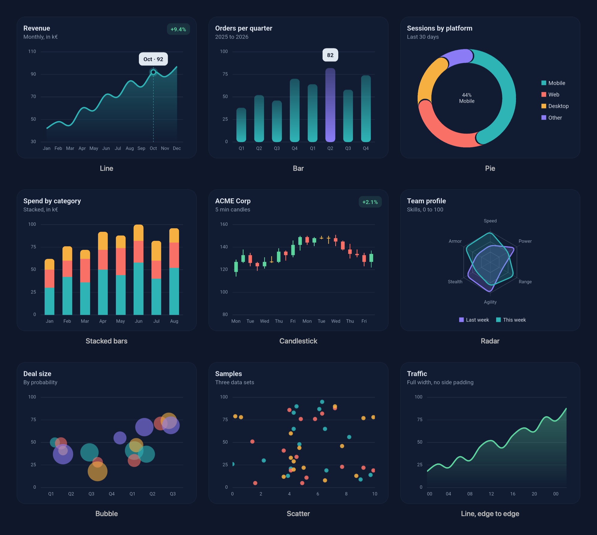
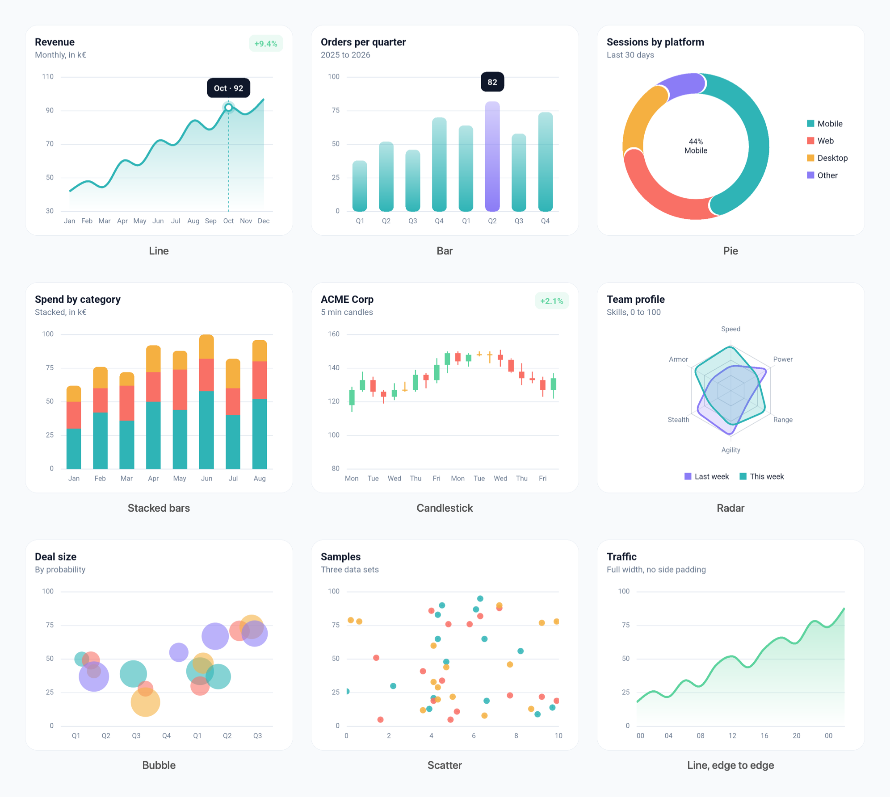
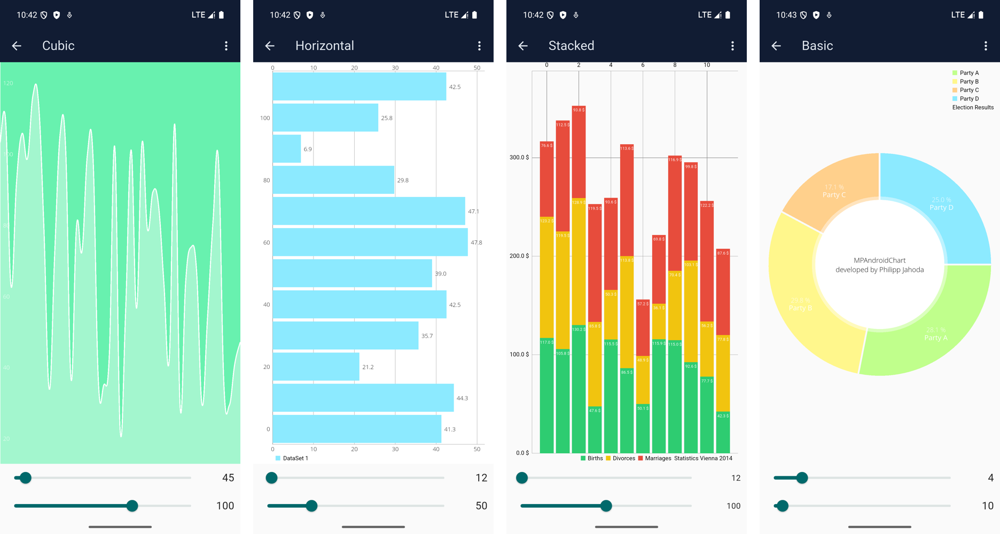

# MPFlutterChart

[English](README.md) | 简体中文

pub.dev 上的包名是 [`mp_flutter_chart`](https://pub.dev/packages/mp_flutter_chart)。

- 官网：<https://www.famakeji.top/mpflutterchart/>
- 在线体验：<https://www.famakeji.top/mpflutterchart/demo/>，即示例 App 的 Web 版，直接在浏览器中运行

[MPAndroidChart](https://github.com/PhilJay/MPAndroidChart) v4.0.1 的 Flutter 移植版，按类逐一移植：类名和成员名与
MPChartLib 保持一致，用纯 Dart 基于 `dart:ui` 编写，上层再提供一层 Flutter widget。支持 Android、iOS 和鸿蒙
（OpenHarmony Flutter）；由于是纯 Dart 实现，也可以构建到 Web 和桌面端。

## 效果展示

示例 App 的首页用统一的样式展示所有图表类型，分深色和浅色两种，和 MPChartExample 一样。以下是 Flutter 示例 App 在
Android 上的截图，图表均由本库绘制。





示例 App 的其他页面对应 MPChartExample 的各个 Activity，下图是 Cubic line、Horizontal bar、Stacked bar 和 Basic pie
页面。



## 基于 MPAndroidChart

本库是 **MPAndroidChart** 的衍生作品。MPAndroidChart 由 Philipp Jahoda 及其贡献者开发，采用 Apache License 2.0
许可。本库移植自 <https://github.com/PhilJay/MPAndroidChart> 的 Kotlin 源码（v4.0.1），对应 `master` 分支的提交
`fae4ad798564ea9ad494eaf037dca0e745400723`。

- 图表相关的类（`Chart`、`BarLineChartBase`、各种数据集、坐标轴、渲染器、高亮器、触摸监听器、`ViewPortHandler`、
  `Transformer` 等）保留了 MPChartLib 的命名、结构和行为，使用 MPAndroidChart 的代码和经验可以直接沿用。
- Android 的 `Canvas`、`Paint`、`Path` 和 `Matrix` 换成了基于 `dart:ui` 的轻量封装，Android 的触摸处理换成了 Flutter
  手势。移植版必须与 Android 不同的地方，以及不同的原因，都列在 [`MIGRATION.md`](MIGRATION.md)（英文）中。
- 原版权声明保留在 [`NOTICE`](NOTICE) 中。

本项目与 MPAndroidChart 的作者没有关联，也未获得其背书。

## 图表类型

| 图表 | Widget | 数据 |
|---|---|---|
| 折线图 | `LineChart` | `LineData` |
| 柱状图 | `BarChart` | `BarData` |
| 横向柱状图 | `HorizontalBarChart` | `BarData` |
| 散点图 | `ScatterChart` | `ScatterData` |
| K 线图 | `CandleStickChart` | `CandleData` |
| 气泡图 | `BubbleChart` | `BubbleData` |
| 饼图 | `PieChart` | `PieData` |
| 雷达图 | `RadarChart` | `RadarData` |

所有图表都支持 MPAndroidChart 的坐标轴、图例、描述、标记（marker）、高亮、数值格式化和动画。折线、柱状等坐标轴类图表
支持拖动、双指缩放、双击缩放和惯性滑动；饼图和雷达图支持触摸旋转。`CombinedChart` 尚未移植。

## 安装

```yaml
dependencies:
  mp_flutter_chart: ^0.1.3
```

需要 Flutter 3.35 或更高版本（Dart 3.9 或更高版本）。

## 快速上手

```dart
import 'package:flutter/material.dart' hide Easing; // Material 3 有自己的 `Easing`
import 'package:mp_flutter_chart/mp_flutter_chart.dart';

class SalesChart extends StatefulWidget {
  const SalesChart({super.key});

  @override
  State<SalesChart> createState() => _SalesChartState();
}

class _SalesChartState extends State<SalesChart> {
  final controller = ChartController(); // 可选：选中、缩放、动画
  final data = LineData([
    LineDataSet([Entry(x: 0, y: 3), Entry(x: 1, y: 5), Entry(x: 2, y: 4)], 'Sales')
      ..mode = LineDataSetMode.CUBIC_BEZIER,
  ]);

  @override
  void dispose() {
    controller.dispose();
    super.dispose();
  }

  @override
  Widget build(BuildContext context) => SizedBox(
    height: 300,
    child: LineChart(
      data: data,
      controller: controller,
      // 在设置数据之前，用图表对象（`LineChartView`，即 MPAndroidChart 的 `LineChart`）执行一次。
      setup: (chart) => chart.axisRight.isEnabled = false,
    ),
  );
}
```

通过 `controller.animateX(1000)`、`controller.fitScreen()` 和 `controller.selectedEntry`（可用 `ListenableBuilder`
监听）来控制和读取图表。其他图表 widget 的参数相同，它们的 `setup` 和 `update` 回调拿到的分别是 `BarChartView`、
`HorizontalBarChartView`、`ScatterChartView`、`CandleStickChartView`、`BubbleChartView`、`PieChartView` 或
`RadarChartView`，也就是带有完整 API 的 MPAndroidChart 图表对象。

本库有两个入口：

- `package:mp_flutter_chart/mp_flutter_chart.dart`：widget，以及它们用到的 MPChartLib 类。
- `package:mp_flutter_chart/core.dart`：只有 MPChartLib 的类，其中 `LineChart`、`BarChart` 等图表名就是图表类本身。

每个文件只导入其中一个（同时导入会让这八个图表名产生歧义），或者给 `core.dart` 加上前缀导入。

## 示例

[`example/`](example) 是一个 Flutter App，包含 Android、iOS 和鸿蒙工程。首页列表与 MPChartExample 一致，每一项打开
对应 Activity 的移植页面：「All chart types」展示页有深色和浅色两种 Nightfall 样式，其余每一项都有自己的页面，包含该
Activity 的图表设置、数据、选项菜单和控件。Combined Chart 和 From Java 两项没有页面，详见
[`example/README.md`](example/README.md)（英文）。

```sh
cd example
flutter run
```

## 开发

```sh
flutter pub get
flutter analyze
flutter test --exclude-tags golden,perf
dart run tool/api_parity.dart --scope=all
```

- `flutter test --platform chrome test/unit test/widget` 在浏览器中运行单元测试和 widget 测试。
- `golden` 测试（`test/golden/`）与在 macOS 上渲染的 PNG 进行比对，在其他系统上会跳过；在 macOS 上用
  `flutter test --update-goldens test/golden` 重新生成。
- `perf` 测试（`test/perf/`）输出大数据量下的耗时，没有阈值。
- `tool/api_parity.dart` 将 `lib/src` 与 MPChartLib 的公开 API 导出（`tool/MPChartLib.api`）进行比对打分，有意不移植的
  符号列在 `tool/api_whitelist.yaml` 中。详见 [`tool/README.md`](tool/README.md)（英文）。

鸿蒙平台请使用 [OpenHarmony Flutter SDK](https://gitcode.com/openharmony-tpc/flutter_flutter)：把 `OHOS_FLUTTER`
设为它的 `bin/flutter`，然后通过 `tool/flutter.sh` 运行命令；或者用 `scripts/ohos_build.sh --install` 构建并安装示例
App。鸿蒙真机需要 DevEco Studio 生成的签名配置；没有签名配置时，构建会停在未签名的 HAP，模拟器可以通过 `hdc install`
安装它。

## 许可证

Apache License 2.0，见 [`LICENSE`](LICENSE)。MPAndroidChart 的原版权声明（Philipp Jahoda，2014-2026）保留在
[`NOTICE`](NOTICE) 中。
